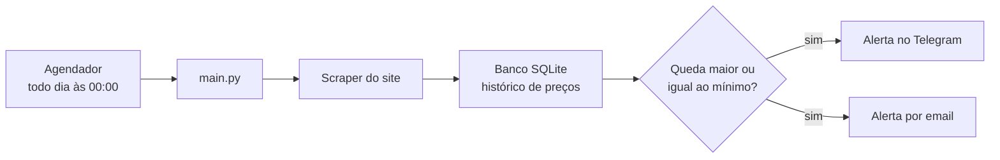
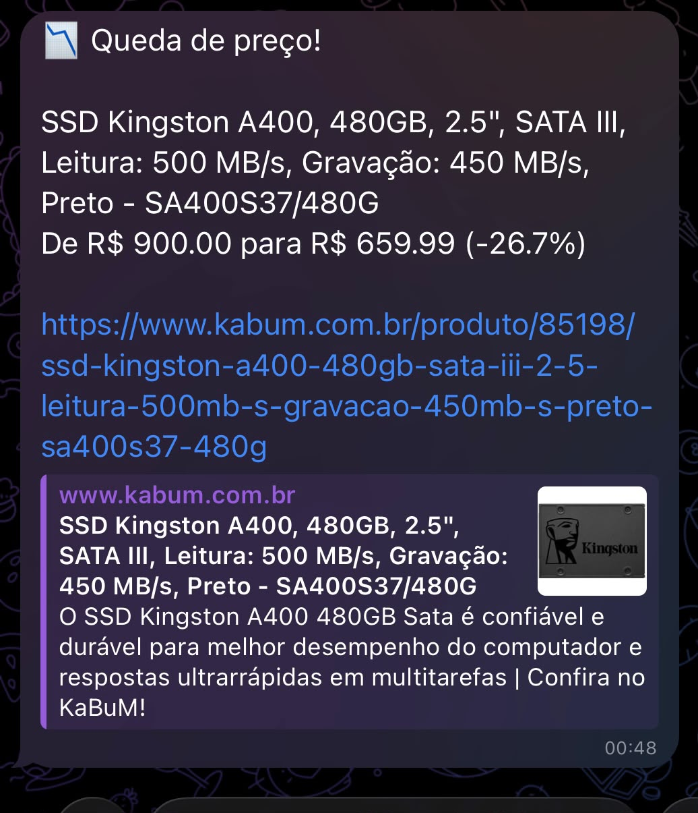
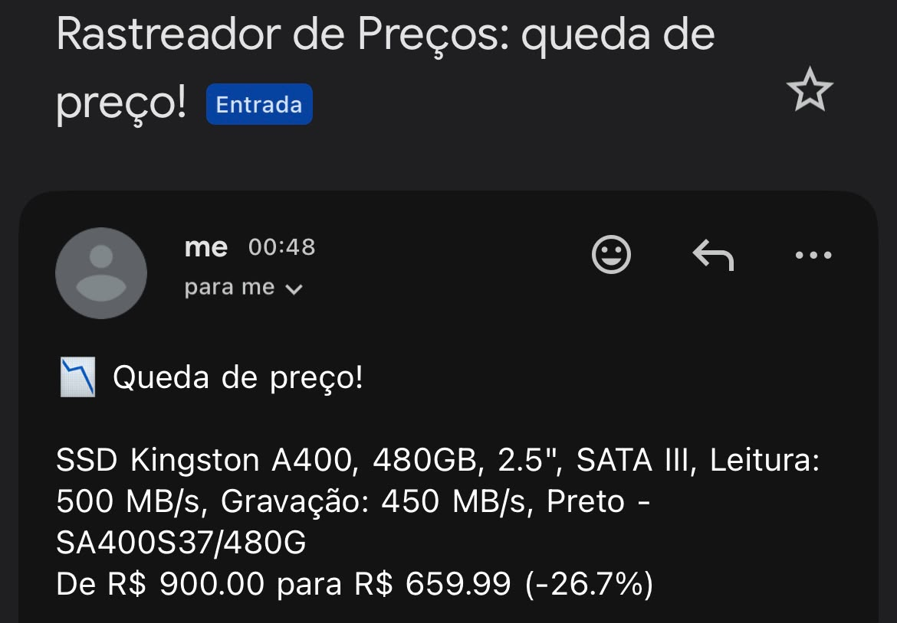
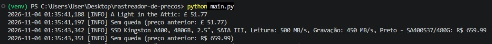

# Rastreador de Preços

Script em Python que monitora o preço de produtos em lojas online, guarda o histórico em um banco de dados e **avisa por Telegram e email quando o preço cai**. Roda sozinho todo dia, à meia-noite.


## Como funciona



Para cada produto da lista, o programa lê o preço atual na página da loja, compara com a última coleta guardada no banco e, se a queda for de pelo menos 5% (configurável), envia o alerta.

**Exemplo de alerta:**

```
📉 Queda de preço!

SSD Kingston A400, 480GB, 2.5", SATA III
De R$ 900.00 para R$ 659.99 (-26.7%)

https://www.kabum.com.br/produto/...
```
<p>
  
  
</p>

## Funcionalidades

- Web scraping de páginas de produto (lojas diferentes, um scraper por site)
- Histórico de preços em banco de dados SQLite
- Alertas por **Telegram** (Bot API) e por **email** (API do SendGrid), ativados conforme a configuração
- Filtro de queda mínima, para não avisar por centavos
- Acompanhamento de vários produtos de uma lista em arquivo de texto
- Agendamento diário (Agendador de Tarefas do Windows ou cron)
- Logs em arquivo e tratamento de falhas: se um produto falhar, os outros continuam
- Testes automáticos com pytest

## Tecnologias

Python · requests · BeautifulSoup · SQLite · API do Telegram · API do SendGrid · python-dotenv · pytest

## Estrutura do projeto

```
rastreador-de-precos/
├── main.py                    # ponto de entrada (o agendador chama este arquivo)
├── produtos.example.txt       # modelo da lista de produtos
├── .env.example               # modelo das variáveis de configuração
├── requirements.txt
├── requirements-dev.txt
├── src/
│   ├── config.py              # lê as configurações do .env
│   ├── produtos.py            # carrega a lista de produtos
│   ├── database/
│   │   └── repository.py      # acesso ao banco (SQL)
│   ├── scrapers/
│   │   ├── base.py            # modelo (Produto e BaseScraper)
│   │   ├── books_toscrape.py  # site de treino
│   │   ├── kabum.py           # Kabum
│   │   └── registry.py        # escolhe o scraper pelo site do link
│   ├── notifiers/
│   │   ├── base.py            # modelo (Notifier)
│   │   ├── telegram_bot.py
│   │   ├── email_sendgrid.py
│   │   └── factory.py         # liga os canais configurados
│   └── services/
│       ├── tracker.py         # coleta, salva e compara os preços
│       └── alertas.py         # monta a mensagem e envia os alertas
└── tests/
```

## Instalação

Requer Python 3.10 ou superior.

```bash
git clone https://github.com/SEU_USUARIO/rastreador-de-precos.git
cd rastreador-de-precos
python -m venv venv
```

Ative o ambiente virtual:

```bash
# Windows (PowerShell)
venv\Scripts\Activate.ps1

# Linux / Mac
source venv/bin/activate
```

Instale as dependências:

```bash
pip install -r requirements.txt
```

## Configuração

Copie os arquivos de exemplo:

```bash
# Windows
copy .env.example .env
copy produtos.example.txt produtos.txt

# Linux / Mac
cp .env.example .env
cp produtos.example.txt produtos.txt
```

Preencha o `.env`:

| Variável | Descrição |
|---|---|
| `TELEGRAM_TOKEN` | Token do bot, criado com o [@BotFather](https://t.me/BotFather) |
| `TELEGRAM_CHAT_ID` | Número da sua conversa com o bot |
| `SENDGRID_API_KEY` | Chave de API do SendGrid, com permissão apenas de *Mail Send* |
| `EMAIL_REMETENTE` | Email verificado no SendGrid (Single Sender) |
| `EMAIL_DESTINO` | Email que receberá os alertas |
| `QUEDA_MINIMA_PERCENTUAL` | Queda mínima (em %) para enviar alerta. Padrão: 5 |

Os dois canais são **opcionais**: cada um só é ativado se as suas variáveis estiverem preenchidas.

> O arquivo `.env` contém segredos e **não** vai para o Git.

**Para descobrir o Chat ID:** mande uma mensagem para o seu bot e abra `https://api.telegram.org/bot<SEU_TOKEN>/getUpdates` no navegador.

## Uso

Coloque os links das páginas de produto no `produtos.txt`, um por linha. Sites suportados: `books.toscrape.com` (site de treino) e `kabum.com.br`.

```bash
python main.py
```

Exemplo do que aparece no log (também gravado em `logs/rastreador.log`):

```
2026-11-05 00:00:03,412 [INFO] A Light in the Attic: £ 51.77
2026-11-05 00:00:03,413 [INFO] Sem queda (preço anterior: £ 51.77)
2026-11-05 00:00:04,101 [INFO] SSD Kingston A400, 480GB...: R$ 659.99
2026-11-05 00:00:04,102 [INFO] Queda de 26.7% detectada! Alertas enviados.
```


Na primeira coleta de um produto não há alerta, porque ainda não existe preço anterior para comparar.

## Agendamento

**Windows (Agendador de Tarefas):** crie uma tarefa diária às 00:00 com:

- Programa: `C:\caminho\do\projeto\venv\Scripts\python.exe`
- Argumentos: `main.py`
- Iniciar em: `C:\caminho\do\projeto`

**Linux / Mac (cron):**

```
0 0 * * * cd /caminho/do/projeto && venv/bin/python main.py
```

## Testes

```bash
pip install -r requirements-dev.txt
pytest
```

Os testes não acessam a internet, nem o banco real, nem enviam mensagens: usam páginas HTML simuladas, notificadores falsos e um banco temporário.

## Decisões de projeto

- **Modelos (`BaseScraper` e `Notifier`):** um site ou canal novo é uma classe nova, sem alterar o restante do sistema.
- **Preço à vista:** na Kabum, o scraper acompanha o preço à vista (PIX), e usa o preço normal quando não há desconto. Manter sempre o mesmo tipo evita quedas falsas no histórico.
- **Dados estruturados em vez de seletores de CSS:** os dados do produto são lidos do JSON embutido na página, que costuma mudar menos que o visual do site.
- **Segredos fora do código:** chaves e tokens ficam no `.env`, e o `.env.example` documenta a configuração.
- **Falhas isoladas:** se um produto ou um canal de alerta falhar, os demais continuam, e o erro vai para o log. O log não registra a mensagem completa dos erros de rede, porque ela poderia expor tokens na URL.
- **Caminhos absolutos:** o banco e os logs ficam na pasta do projeto, mesmo quando o script é executado pelo agendador, que roda em outra pasta.

## Como adicionar um novo site

1. Rodar um diagnóstico na página do produto para descobrir onde estão o nome e o preço (HTML, JSON-LD ou `__NEXT_DATA__`).
2. Criar `src/scrapers/novo_site.py` com uma classe que herda de `BaseScraper` e implementa `buscar_produto`.
3. Registrar o domínio em `src/scrapers/registry.py`.
4. Escrever os testes do novo scraper em `tests/test_scrapers.py`.

## Próximos passos

- [ ] Scraper do Mercado Livre (via API oficial)
- [ ] Scrapers da Pichau e da Terabyte
- [ ] Preço-alvo por produto ("avise quando custar menos de X")
- [ ] Pausa entre requisições para listas maiores
- [ ] Execução em servidor (VPS), sem depender do computador ligado

## Aviso

Projeto pessoal e educacional, sem vínculo com as lojas citadas. Respeite o `robots.txt` e os termos de uso de cada site, e mantenha uma frequência baixa de consultas (aqui, um por produto por dia).

## Autor

**Nicole Araújo** · [GitHub](https://github.com/araujonnicole) · [LinkedIn](www.linkedin.com/in/nicolearaujo)